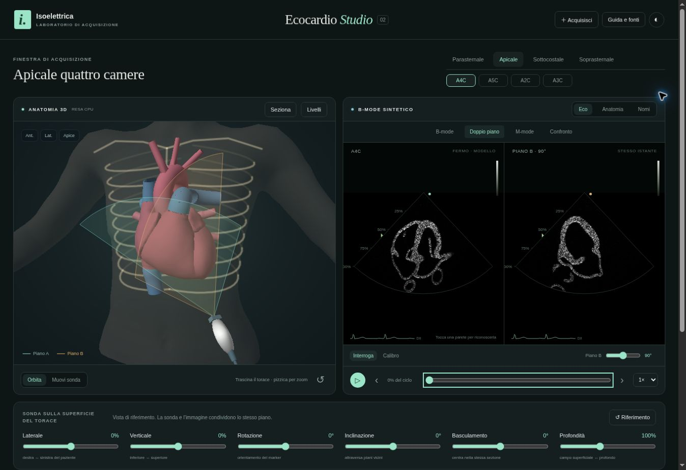

# Ecocardio Studio 02 — revisione v47.1

**Data:** 12 novembre 2026. **Ramo:** `feat/ecocardio-lab-v47`, PR #12. **Revisione precedente:** `a8121e186c9572295613c6872ddce448efd58e16`.

Eli ha chiesto un laboratorio molto più avanzato della prima anteprima e del riferimento EchoSuite. Questa revisione amplia concretamente il motore di immagine e gli strumenti di studio. Non viene dichiarata una superiorità clinica o complessiva rispetto a EchoSuite. La prova diretta del riferimento era stata limitata dall’assenza di WebGL nel browser disponibile; gli screenshot forniti dall’utente restano il riferimento visivo. Nessun asset, filmato o codice di EchoSuite è stato copiato.

## Risultato disponibile

**Ecocardio Studio 02** è pubblicato allo stesso indirizzo privato:

https://isoelettrica-ecocardio-eli.eliseo-peirano.chatgpt.site

Il servizio ha confermato `succeeded` per il commit del sito **`f4af084da5d4494cbe0c6f88522eed0622ada895`**, distribuzione **`appgdep_6af579425a2c8191ba5056f1c4d7f3c9`**. È stato mantenuto il pubblico privato del sito esistente. Il pacchetto contiene gli stessi moduli verificati in anteprima; il collegamento di ritorno apre l’app pubblica.

L’integrazione nell’app principale è conservata nella PR #12; la pubblicazione su GitHub Pages principale rimane distinta da questa anteprima.

## Funzioni realizzate

| Area | Comportamento |
| --- | --- |
| Immagine | Campionamento continuo di un volume tissutale derivato dall’atlante, con texture tridimensionale riproducibile e cavità scure; il piano non seleziona un fotogramma preregistrato |
| Torace e sonda | Torace umano derivato dal paziente MakeHuman già presente, cute/capelli/occhi separati; contatto su una superficie curva, con trasporto dell’orientamento locale; spostamenti controllabili a cursore o trascinando |
| Doppio piano | Due sezioni con origine, asse centrale e istante condivisi; angolo del piano B regolabile, con entrambi i piani visibili nel 3D |
| M-mode | Scelta della linea sul settore o tramite cursore; accumulo dei campioni di intensità lungo la linea nel tempo del modello; storia azzerata cambiando sonda o impostazioni |
| Anatomia collegata | Selezione di una parete nel settore, nome e spiegazione, evidenziazione della stessa struttura e del punto nel 3D; sezionamento della scena per osservare l’interno |
| Cine | Pausa, riproduzione, velocità, scorrimento del ciclo e passi di fotogramma; un unico istante guida scena e settori |
| Immagine e calibro | Guadagno, contrasto, fuoco, settore e TGC a tre zone con valori relativi; distanza fra due punti in unità dell’atlante |
| Acquisizioni | Ultimi quattro fotogrammi conservati nel browser con vista, sonda, immagine e fase; ripristino o confronto con l’immagine corrente; esportazione PNG implementata |
| Percorso | Otto esercizi su orientamento, riconoscimento, doppio piano, guadagno, M-mode e cine; condizioni osservabili di riuscita e distinzione persistente fra prove assistite e autonome |

L’interfaccia è italiana, con tema chiaro/scuro e pannelli di studio separati. Rimangono undici preset geometrici. La finestra apicale è stata corretta e reinquadrata; il contatto soprasternale usa un riferimento dedicato. Le coste restano illustrative, con tratto posteriore attenuato per ridurre la sovrapposizione grafica. Il bordo inferiore del torace viene tagliato geometricamente su un piano.

## Motore e provenienza

Il GLB originale a 39 strutture è immutato. Il volume usa 33 superfici selezionate, comprendenti pareti, vasi, lembi e ricostruzioni già presenti. La griglia comprende **128 × 204 × 120 celle** con passo **0,024 unità dell’atlante**. `tissue.bin` occupa **1.475.300 byte**, `body.bin` **383.101 byte**. Questi numeri descrivono la discretizzazione del software, non misure anatomiche del paziente.

Il generatore combina le intersezioni delle pareti su tre assi, esclude raggi con conteggi non chiusi e limita le ricostruzioni alla prossimità delle superfici. I vasi sono resi come gusci illustrativi; le superfici valvolari sottili ricevono uno spessore di visualizzazione. La struttura semantica è attribuita per prossimità alla geometria sorgente. Il dizionario è stato aggiornato verificando che vertici, indici e dati dei voxel rimanessero identici. `tissue.json` registra inventario, algoritmo, licenza e SHA-256 dell’esportazione.

Il volume viene campionato attraverso l’inversa della stessa deformazione CardiacMechanics applicata al cuore. Il test dell’inversa confronta i punti con la deformazione originale con tolleranza 0,00012 in unità dell’atlante, inferiore al passo della griglia. CardiacClock legge gli eventi del ritmo sinusale senza modificarli. Il cine ripete un ciclo del modello; non rappresenta un’acquisizione clinica.

Il renderer CPU aggiunto usa profondità, normali interpolate, selezione e taglio delle superfici, conservando un percorso funzionante senza WebGL. Three.js e i moduli esistenti restano lo stack dell’app. Non sono state introdotte dipendenze applicative. NumPy e SciPy servono solo per rigenerare gli asset fuori dal browser. Procedura riproducibile in `ecocardio/README.md`.

## Verifiche effettuate

**Suite completa:** `npm test` superato: **191 test Node, 5 test Python**, validatori originali, **28 regole ST**, **329 controlli diagnostici** e **522 combinazioni dell’audit**. I controlli ECG verificano le regressioni dell’app preesistente, non la validità clinica del nuovo laboratorio.

**Modulo Ecocardio:** tutti i **15 test** sono passati anche dopo gli ultimi aggiornamenti. Coprono geometria e sezioni dell’atlante, contorni aperti, assi e coordinate, contatto sulla cute, completezza del volume, riproducibilità delle immagini, risposta a guadagno e orientamento, inversa del moto, doppio piano, campionamento M-mode, obiettivi degli esercizi, stato DOM, acquisizione immediata dopo una modifica, iframe e precache. Un’attesa del test è stata corretta per attendere il fotogramma dopo l’input; il confronto della superficie usa una tolleranza numerica anziché uguaglianza esatta in virgola mobile.

**Browser reale disponibile:** verificati caricamento senza WebGL, PLAX/A4C/arco, doppio piano e angolo B, Eco/Anatomia, selezione di una parete con evidenziazione nel 3D, sezionamento, riproduzione e pausa, scorrimento del ciclo, M-mode con storia campionata, cambio della linea, acquisizione, confronto, ripristino e persistenza dell’acquisizione dopo ricaricamento. Il trascinamento sul torace ha aggiornato entrambi gli spostamenti (laterale 24%, verticale 21%) e le strutture attraversate. L’esercizio PLAX ha rilevato l’errore; il reset ha prodotto una prova assistita lasciando il contatore autonomo a 0/8.

**Correzioni emerse dalla verifica:** bloccata una crescita progressiva dell’altezza entrando in M-mode; il settore ora mantiene un’altezza di 402 px alla larghezza desktop provata, con storia e settore contenuti nello stesso pannello. L’acquisizione forza l’aggiornamento del fotogramma quando i controlli sono appena cambiati. Il confronto ignora il caricamento di un’immagine non più selezionata. Corrette l’inquadratura apicale e la discontinuità del taglio inferiore del torace.

**Esportazione:** il comando PNG è implementato con etichetta di immagine sintetica; la verifica del download attraverso il connettore del browser è andata in timeout e non viene dichiarata completata. Il salvataggio interno, il confronto e il ripristino delle acquisizioni sono invece stati verificati.

**Integrità:** confermati invariati tutti i nove SHA-256 di riferimento: `engine.js`, `data.js`, `quiz.js`, `ipertrofie.js`, `atlante-digitale.js`, `ptbxl.js`, `coronarie.js`, `cuore3d.js`, `prototipo-cuore/heart-z-anatomy.glb`. Verifica del diff senza errori di spaziatura. Cache e riferimenti dell’integrazione aggiornati coerentemente a v47.1.

## Limiti aperti

- Le immagini sono sintetiche e derivano da un atlante incompleto. Ricostruzione volumetrica, registrazione nel torace e orientamenti dei preset richiedono revisione specialistica.
- Mancano simulazione acustica fisica, ombre costali fisiche, Doppler, emodinamica, patologie ecocardiografiche e clip cliniche autorizzate. Le valvole non seguono una cinematica passiva guidata da pressioni.
- Fuoco, guadagno, TGC e attenuazione sono controlli grafici relativi. Non sono parametri calibrati di un ecografo.
- M-mode è derivato dai campioni del modello alla frequenza effettiva di rendering; non acquisisce una risoluzione temporale superiore al B-mode. Il tempo mostrato è tempo simulato.
- Il calibro usa unità dell’atlante. Nessuna FE, volume clinico, misura in centimetri o valutazione diagnostica viene ricavata.
- Coste, contatto e postura sono illustrativi; non viene simulata pressione sulla cute. VCI limitata al tratto toracico.
- WebGL su hardware reale, Safari e iPad, touch multiplo su dispositivo, prestazioni e modalità aereo restano da verificare. Il browser della verifica usa il percorso CPU.
- Progressi e acquisizioni sono salvati nel browser corrente, con limite di quattro immagini; non esiste sincronizzazione fra dispositivi né certificazione di competenza.

## Prova visiva

Apri **Apicale → A4C → Doppio piano** e muovi l’angolo B. Passa a **Anatomia**, tocca una parete e attiva **Seziona**. Per il tempo, apri **Parasternale → PSAX · Pap → M-mode**, scegli una linea e riproduci il ciclo. Per il recupero di una sessione, usa **Acquisisci → Acquisizioni → Riapri**.

## Fonti e licenze

- ASE 2019, *Guidelines for Performing a Comprehensive Transthoracic Echocardiographic Examination in Adults*, DOI 10.1016/j.echo.2018.06.004: https://www.asecho.org/wp-content/uploads/2019/01/2019_Comprehensive-TTE.pdf. Riferimento per movimenti della sonda e concetti di ottimizzazione dell’immagine; non fornisce i valori numerici del modello.
- BSE, *A practical guideline for performing a comprehensive transthoracic echocardiogram in adults: the BSE minimum dataset*, DOI 10.1530/ERP-20-0026: https://pmc.ncbi.nlm.nih.gov/articles/PMC7923056/.
- Atlante e volume derivato: Z-Anatomy CC BY-SA 4.0 / BodyParts3D CC BY-SA 2.1 JP. Torace derivato da MakeHuman CC0. Adattamenti e licenze in `prototipo-cuore/ATTRIBUZIONI.md`.

Questa revisione non completa i prompt clinici 02–09 del kit di sviluppo. Test software e revisione automatica non equivalgono a una validazione cardiologica.
