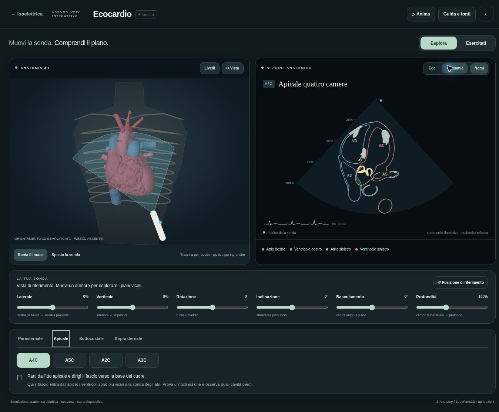

# Ecocardio — prima versione interattiva v47

**Data:** 12 novembre 2026. **Ramo:** `feat/ecocardio-lab-v47`. **Base:** `e35f7ea59064c4d6e9170ab345d30427a5697b25` (v46.2).

Eli ha richiesto una funzione analoga al laboratorio ecocardiografico mostrato negli screenshot di EchoSuite, fornendo poi https://echosuite.app per provarla. Il riferimento è stato aperto, ma il browser ha mostrato «Error creating WebGL context»: non sono state provate le interazioni della sonda di EchoSuite. Sono stati consultati guida e attribuzioni. Nessun codice, modello o filmato proprietario è stato copiato.

## Risultato

Moduli nuovi in `ecocardio/`: nucleo geometrico indipendente dal DOM, dizionario e preset, scena 3D con torace illustrativo, rendering delle sezioni, interfaccia italiana e host a caricamento differito. L’integrazione aggiunge la scheda Ecocardio; il laboratorio conserva il proprio stato al cambio di scheda e sospende la simulazione quando non è visibile.

Sonda, marker, piano e sezione sono collegati geometricamente. Il taglio interseca le superfici reali del modello, senza scegliere un’immagine preregistrata. Sei cursori e trascinamento controllano posizione e orientamento; profondità e angoli sono relativi al preset. Sono disponibili 11 riferimenti: PLAX, tre livelli PSAX, quattro apicali, SC4C, VCI toracica e arco. L’A2C è stata corretta dopo il confronto dei tagli, per escludere quasi tutta la superficie del ventricolo destro. La presenza delle strutture attese è verificata geometricamente; questo non certifica che l’immagine corrisponda a una corretta acquisizione clinica.

Anatomia a colori ed eco sintetica mostrano lo stesso taglio. L’animazione legge gli eventi del ritmo sinusale tramite CardiacClock; sezione e superfici 3D condividono CardiacMechanics. La modalità esercizio introduce un disallineamento e dà un riscontro su posizione, angoli e profondità. Livelli, opacità, sonda guida, orbita, zoom e tema completano la navigazione.

## Confini espliciti

- Sezioni geometriche con resa grafica: niente propagazione acustica, attenuazione, ombre costali, Doppler, clip cliniche, misure o patologie ecocardiografiche.
- Coordinate dell’atlante, profondità percentuale, angoli relativi e soglie di allineamento sono parametri dell’interfaccia; non sono centimetri, range fisiologici o un punteggio di competenza clinica.
- Torace, coste e punto di contatto sono illustrativi; il trascinamento usa una superficie piana locale e non simula il contatto fisico sulla cute. I preset non modellano le posture del paziente.
- L’atlante sorgente non contiene tutti i lembi e le corde valvolari. VCI limitata al tratto toracico. Superfici aperte restano aperte; si evita di riempire arbitrariamente i lumi delle camere. Lo spessore luminoso del contorno è grafico.
- I preset e i loro orientamenti devono essere rivisti da uno specialista. Possono mostrare parti di altre strutture; non sono riferimenti validati per imparare ad acquisire un esame su paziente.
- Nessuna modifica al motore, ai dati clinici, ai quiz o al GLB sorgente. Nessun avanzamento implicito dei prompt clinici precedenti.

## Verifiche

**Geometria e interfaccia.** Nove nuovi test verificano: basi ortonormali e reciprocità schermo/spazio; sezioni di un solido noto e contorni aperti; distinzione tra rotazione, inclinazione, basculamento e profondità; strutture attraversate nei preset sull’atlante completo; deformazione comune; obiettivi dell’esercitazione; gestione DOM senza WebGL; iframe unico a caricamento differito; dipendenze presenti nel precache con l’esatto URL.

**Regressioni.** La suite comprende 185 test Node. La prima esecuzione ha superato 182 test e rilevato tre attese di test legate alla vecchia versione: numero di schede e versioni future dell’avviso PWA. Le attese sono state aggiornate senza cambiare il comportamento dell’app; tutti i 12 test dei due gruppi coinvolti sono passati. I nove test Ecocardio sono stati ripetuti dopo l’ultima correzione di inquadratura e sono passati. Passati inoltre i cinque test Python, i validatori originali, le 28 regole ST, i 329 controlli diagnostici e le 522 combinazioni dell’audit. Questi ultimi verificano l’ECG preesistente, non validano clinicamente l’ecocardio.

**Browser.** Anteprima locale aperta in Chrome tramite la funzione di anteprima Sites. Verificati caricamento, navigazione Ecocardio nella shell, passaggio PLAX/A4C/arco, Eco/Anatomia, esercitazione, rotazione via tastiera, sonda di riferimento, reset, riscontro di allineamento, avvio/pausa e trascinamento della sonda. Il trascinamento ha modificato posizione e punteggio (100% → 35%). Il browser non dispone di WebGL: la prova visiva riguarda il percorso software, che mostra le stesse superfici semplificate per il disegno; i tagli usano la geometria completa. WebGL su hardware reale, Safari e iPad non verificati. Impaginazione responsive presente, verifica su dispositivo reale aperta.

**Offline.** Tutti gli URL delle dipendenze del modulo sono verificati contro il precache; il modello già presente è riutilizzato. La prova completa in modalità aereo su iPad resta aperta.

**Integrità.** I nove SHA-256 di riferimento registrati prima dell’intervento sono invariati: engine.js, data.js, quiz.js, ipertrofie.js, atlante-digitale.js, ptbxl.js, coronarie.js, cuore3d.js e prototipo-cuore/heart-z-anatomy.glb. Nessuna nuova dipendenza applicativa.

## Anteprima e stato della distribuzione

Anteprima privata pubblicata: https://isoelettrica-ecocardio-eli.eliseo-peirano.chatgpt.site

Il servizio ha confermato la distribuzione riuscita della versione del sito `ea3050006659d36e98a5395e8b3cf452c19f25bf`. Il sito richiede accesso con ChatGPT; il browser di verifica si è fermato alla pagina di accesso, senza richiedere credenziali a Eli. L’interfaccia è stata verificata nell’anteprima locale. Il pacchetto pubblicato contiene gli stessi moduli e asset; cambia solo il collegamento di ritorno, diretto all’app pubblica.

La pagina GitHub Pages principale rimane v46.2; l’integrazione v47 è proposta in un ramo separato. L’anteprima privata permette di provare il modulo prima dell’integrazione pubblica.

## Prova visiva rapida

Apri **Apicale → A4C → Anatomia**, inclina il piano e osserva come cambiano i contorni. Ripristina la posizione, passa a **Esercitati** e attiva **Livelli → Sonda di riferimento**. Per muovere il contatto direttamente, seleziona **Sposta la sonda** e trascina nel pannello sinistro.

## Fonti

- ASE 2019, *Guidelines for Performing a Comprehensive Transthoracic Echocardiographic Examination in Adults*, DOI 10.1016/j.echo.2018.06.004: https://www.asecho.org/wp-content/uploads/2019/01/2019_Comprehensive-TTE.pdf
- BSE, *A practical guideline for performing a comprehensive transthoracic echocardiogram in adults: the BSE minimum dataset*, DOI 10.1530/ERP-20-0026: https://pmc.ncbi.nlm.nih.gov/articles/PMC7923056/
- Licenze e limiti del modello: `prototipo-cuore/ATTRIBUZIONI.md` e `SOURCE-LICENSE.txt`.
