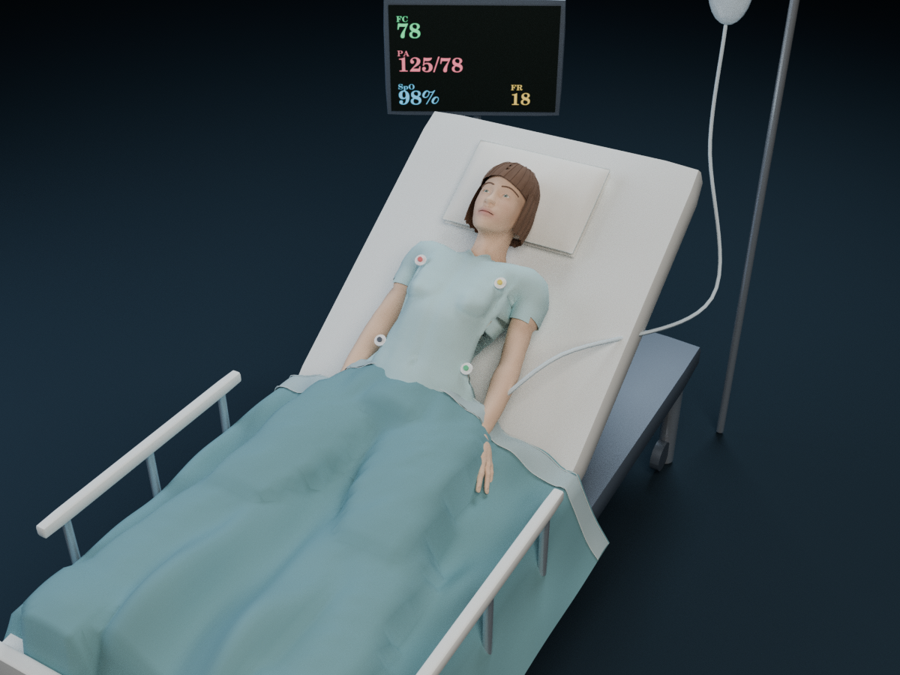

# Isoelettrica v46.2 — kit v46.1 e revisione del paziente

## Richiesta e integrazione

Eliseo ha chiesto di caricare il kit v46.1 e migliorare il paziente, evidenziando coperta gonfia e capelli poco visibili. Base: `183a047` (v46.0 già pubblicata). Le 20 impronte del nuovo kit sono state verificate. La logica dei casi è stata integrata con merge a tre vie, conservando il reset del segnale durante i download e l’avviso 3D deduplicato già corretti nella v46.0. La pubblicazione della revisione migliorata è autorizzata dalla richiesta.

Dal kit: Turno di guardia di dieci chiamate, calcoli di dose, spiegazioni delle alternative e scheda del tracciato. Nessuna modifica a casi-dati.js, casi-reali.js, motore ECG, dati o quiz preesistenti.

## Revisione grafica

- Coperta aperta con pieghe, cuciture e risvolto sottile. La superficie viene adattata ai vertici delle gambe dopo lo skinning quando cambia la postura; il bordo scende oltre il materasso. Non è una simulazione di stoffa dinamica.
- Capelli con volume, attaccatura, ciocche e nuca; taglio corto e caschetto, con tonalità distinte per età. Geometrie separate dalla cute.
- Iridi, pupille, riflessi, sopracciglia e variazioni cromatiche di labbra/guance. Nell’incoscienza le iridi si nascondono e la superficie dell’occhio assume il colore della cute; non è una mimica facciale completa.
- Camice separato dal corpo, con margine dello scollo ritagliato per interpolazione e pieghe leggere. Pesi di skinning normalizzati per evitare intersezioni durante il respiro.
- Letto con bordi raccordati, federa rettangolare, sponde, ruote e ombre; mani delle compressioni con dita e palmi, ancora schematiche.
- Camera ferma a riposo, rotazione con un dito, zoom con due dita o pulsanti, ripristino della vista e controlli raggiungibili da tastiera.
- Capelli e camici riutilizzati per ciascuna variante; ciocche unite in un unico disegno. Nessuna dipendenza aggiunta al sito.

Il binario del kit aveva quattro insiemi di posizioni identici, verificati per hash. La distinzione delle proporzioni è ora applicata esplicitamente in `casi-paziente-aspetto.js`, in modo coerente a superficie, giunti e ancore. Le forme sono illustrative, non ricostruzioni individuali o modelli fisiologici validati.

## Verifiche

- `npm ci --ignore-scripts`: completato.
- `npm test`: **176/176 Node + 5/5 Python**; 102 scenari, 329 criteri, 28 regole ST e 522 combinazioni di parametri.
- Test delle quattro corporature e delle pose: coordinate finite, pesi normalizzati, una sola testa/un solo camice attivi al cambio del paziente, occhi e controlli della camera coerenti.
- Turno di guardia: dieci chiamate senza correzione anticipata, riepilogo e punteggio; salto delle chiamate e nuovo turno. Restano coperti tutti i 15 casi e le 66 decisioni.
- Nove hash protetti verificati invariati: engine.js, data.js, quiz.js, ipertrofie.js, atlante-digitale.js, ptbxl.js, coronarie.js, cuore3d.js, prototipo-cuore/heart-z-anatomy.glb.
- Verifica visiva offline delle geometrie effettive della scena Three.js: donna semiseduta, uomo anziano semiseduto, uomo supino durante le compressioni, anche da lato. Corrette intersezioni di gambe/tessuto, bordo del materasso e camice.

### Come leggere l’anteprima

L’immagine seguente è un **render geometrico di controllo**, non uno screenshot del sito né un’immagine generata da un modello. L’esportatore esegue il modulo Three.js, applica ossa e pesi, e salva le superfici già posate, la camera e la texture del monitor. Blender 4.3.2 le rende su CPU con illuminazione di verifica. La luce può differire da quella WebGL dell’app.



Riproduzione facoltativa, con `@napi-rs/canvas` e Blender installati:

```sh
node tools/esporta-paziente.cjs /tmp/paziente.json F 42 semi
blender -b --factory-startup --python tools/render-paziente.py -- /tmp/paziente.json /tmp/paziente.png --final
```

## Fonti dei nuovi esercizi del kit

Controllo puntuale dei numeri introdotti dai calcoli, senza estendere la dichiarazione a una revisione clinica completa:

- Eparina non frazionata, bolo 80 UI/kg e infusione 18 UI/kg/h: [ESC ACVC Toolkit 2025, capitolo embolia polmonare](https://www.escardio.org/static-file/Escardio/Subspecialty/ACCA/Publications/Toolkit/ACVC%20TOOLKIT%202025/Toolkit_2025-CHAPTER7-HD.pdf). Il caso specifica alto rischio e prescrizione già stabilita; non è una raccomandazione universale per ogni embolia.
- Adrenalina 2–10 µg/min nella bradicardia instabile dopo trattamento inefficace: [Resuscitation Council UK, ALS 2025](https://www.resus.org.uk/cy/node/36438), coerente con ERC 2025.
- Le diluizioni sono esempi dichiarati nelle domande. La correttezza aritmetica è verificata su 400 estrazioni.

## Limiti aperti e rilascio

Il browser di questa sessione non supporta WebGL, e Chromium locale non può aprire i socket necessari. I rendering offline verificano la geometria, ma non shader, prestazioni GPU o gesti su un iPad reale. La verifica Safari/iPad e la revisione da parte di un cardiologo restano aperte. Restano inoltre i controlli puntuali delle fonti già elencati nel README (Wellens, tamponamento, Brugada, magnesio e colchicina).

La versione e la cache sono portate coerentemente a **46.2**. Il nuovo modulo grafico è incluso nella cache offline. La procedura di rilascio passa da PR, verifiche GitHub e distribuzione GitHub Pages; gli esiti finali vengono registrati nella PR per evitare un secondo rilascio composto solo da documentazione.

Verifica a occhio: aprire Casi clinici, scegliere un caso semiseduto, osservare capelli/camice/coperta; premere + e ↺; aprire Arresto cardiaco e osservare la posa supina e la coperta; avviare un Turno di guardia e completare o saltare le dieci chiamate.
