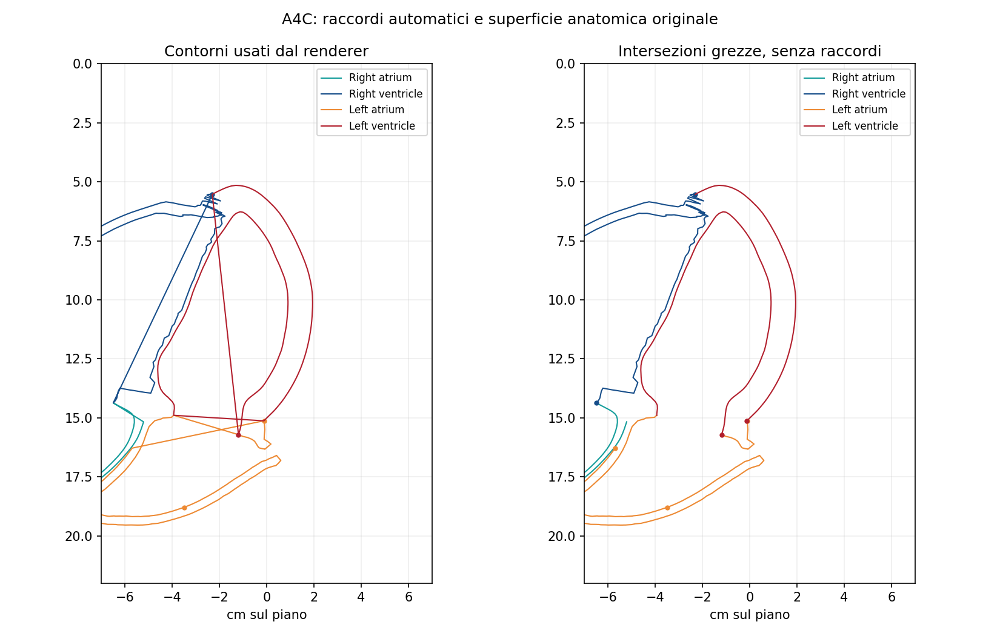
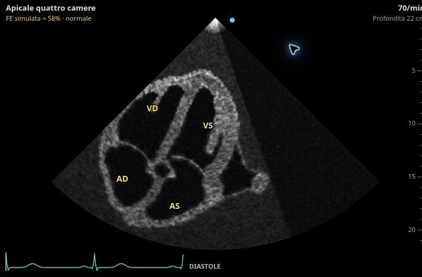

# Eco: contorni artificiali e verifica del browser

## Problema riprodotto

La schermata inviata dall'utente mostra la versione 47.0, A4C con cavità e vasi sovrapposti. La versione in sviluppo 47.2 è stata aperta e controllata visivamente: il B-mode funziona senza GPU, ma presentava ancora frammentazioni e raccordi di tessuto non anatomici. Questo problema non si risolve aumentando il rumore o la risoluzione del nuovo renderer.

`unisci()` concatenava tutti i contorni aperti e impostava `chiusa: true`, senza una distanza massima e senza verificare la continuità della superficie. Nella A4C il bordo di chiusura del VS arrivava a **10,24 cm** nella scala del modello; quello del VD a **9,78 cm**. Questi segmenti non appartengono alla mesh. Il renderer li tracciava e la chiusura morfologica li trasformava in tessuto. Il difetto è presente anche in altre proiezioni.

Il grafico usa le stesse intersezioni del modello Z-Anatomy / BodyParts3D e la calibrazione precedente. Le diagonali del pannello sinistro non sono parti anatomiche. Il confronto spiega l'errore di raccordo; non valida la geometria sorgente.

## Correzione

- Si raccordano soltanto estremi coincidenti entro `1e-4` unità del modello, una tolleranza numerica, non una misura clinica. Le aperture restano aperte quando non esiste una superficie che le chiuda.
- Si conserva una chiusura soltanto quando i due estremi del contorno coincidono entro la stessa tolleranza.
- La correzione illustrativa del setto destro passa dall'85% al 35% del divario geometrico. La vecchia calibrazione, dopo la rimozione delle diagonali spurie, produceva un setto di circa 0,22–0,28 cm nei due campioni PLAX del test. Con la quota ricalibrata: circa 0,74–0,91 cm; parete posteriore circa 1,05 cm. Sono misure del modello, non dati di un paziente né una validazione clinica.
- Il test PLAX legge le tre interfacce necessarie realmente presenti nel VS: endocardio settale, endocardio posteriore, epicardio posteriore. L'altra superficie settale si legge dal VD. Il quarto incrocio della vecchia asserzione poteva provenire dalla diagonale artificiale. Le verifiche di diametro, spessori e rapporto settale restano attive.
- Sonda, gesti, localizzatore 3D originale, motore ECG, dati e GLB sorgente restano preservati.

## Verifica della correzione

I quattro test in `tests/eco-contorni.test.cjs` coprono frammenti distanti, orifizi aperti, raccordi numericamente coincidenti e tutte le nove proiezioni sul GLB effettivo. Per ogni segmento finale si controlla che appartenga a una catena originale oppure che sia un raccordo entro la tolleranza. Prima della correzione fallivano sia il caso sintetico sia il controllo sul cuore reale; dopo passano.

Suite completa: **214 test Node e 5 Python superati**, nessuno saltato. Log in `2026-11-19-eco-f1-npm-test.txt`.

Nel browser sono state acquisite **18 immagini**: nove viste del quadro normale, ciascuna in telediastole e telesistole, motore classico. Indice e immagini sono in `eco-audit/contorni/`. Le schermate sono state ispezionate tramite tre tavole di confronto, conservate nella stessa cartella.

## Limiti ancora visibili

La correzione elimina una causa dimostrata di pareti spurie; **non rende corrette tutte le viste**. Restano aperture e strutture aggiuntive dovute alle mesh, stime valvolari e semplificazioni della parete. In particolare: A4C con regioni basali frammentate e assetto obliquo; PSAX mitrale troppo obliqua; proporzioni e geometria del VD non ancora validate; A3C con sezioni destre aggiuntive. Il movimento resta geometrico. Questi rilievi devono guidare F2 e la revisione dei piani, prima di considerare il nuovo B-mode una soluzione finale.

La prova non copre ancora tutti i quadri patologici e le combinazioni di sonda libera. La sola presenza di una vista o di un test passato non certifica anatomia, acquisizione o fedeltà ecografica.

## WebGL: diagnosi indipendente dall'app

È stata aggiunta la pagina di collaudo `tools/qa-webgl.html`. Il pulsante esegue una prova Canvas 2D / WebGL / WebGL2 senza Three.js, senza modelli anatomici, senza cambiare impostazioni e senza inviare dati a servizi esterni.

Esito effettivo del browser disponibile, Chrome 156 su Linux:

| API | Esito |
|---|---|
| Canvas 2D | Disponibile |
| WebGL | Non disponibile; `GL_VENDOR = Disabled`, `GL_RENDERER = Disabled` |
| WebGL2 | Non disponibile; stesso errore di creazione del contesto |

Il dettaglio è in `eco-audit/contorni/browser-webgl.json`. Il problema di creazione del contesto precede il caricamento dell'app; le immagini B-mode e i difetti anatomici si possono comunque verificare nel percorso Canvas. Il trascinamento 3D di EchoSuite non è stato provato e non viene dichiarato verificato.

È stato tentato l'accesso alla diagnostica interna `chrome://gpu`, rifiutato dalla politica del browser gestito sui protocolli consentiti. Non sono state modificate protezioni né aggirata la restrizione. La verifica pubblica nella pagina di collaudo usa normali API web consentite. Nessun altro browser collegato con supporto WebGL verificato è disponibile in questa sessione. Per chiudere il collaudo 3D serve un ambiente di prova WebGL abilitato, per esempio il browser sul Mac dell'utente; questa sessione non ne ha il controllo.

La pagina di collaudo è pronta anche per confrontare i due ambienti. Non si suggerisce di alterare l'app per simulare falsamente un esito GPU positivo. Il localizzatore 2D rimane una riserva esplicita; la sonda 3D originale non viene sostituita.

## Fonti

- Geometria: Z-Anatomy / BodyParts3D, attribuzioni in `prototipo-cuore/ATTRIBUZIONI.md`.
- Piani e acquisizione: Mitchell et al., ASE 2019, https://www.asecho.org/wp-content/uploads/2019/01/2019_Comprehensive-TTE.pdf
- Riferimenti di quantificazione preesistenti: Lang et al., ASE/EACVI 2015, https://doi.org/10.1016/j.echo.2014.10.003
- Il confronto completo con EchoSuite è in `2026-11-19-echosuite-confronto.md`; l'audit dei calcolatori non sostituisce queste prove di immagine.
