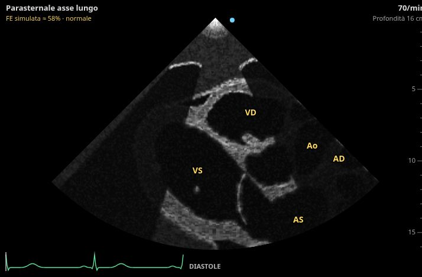
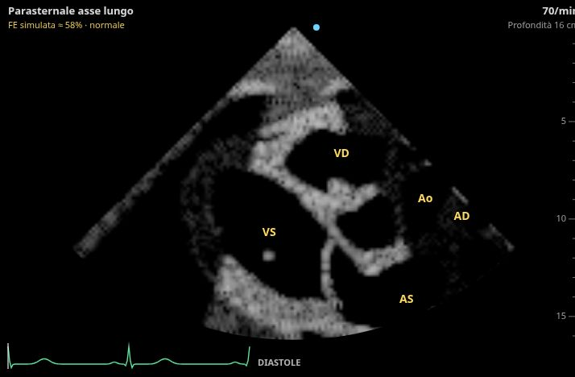
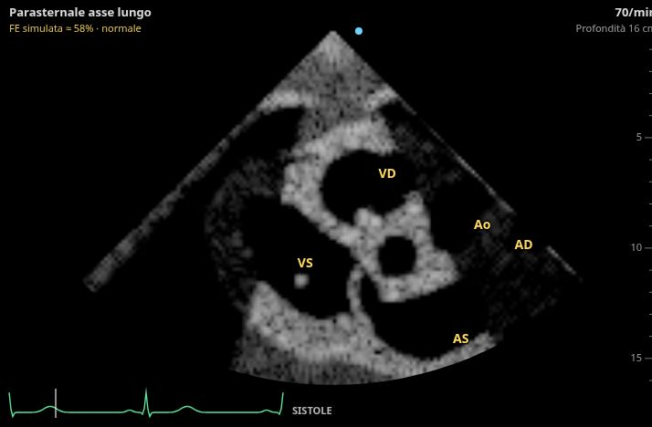

# Eco F1: primo prototipo e confronto EchoSuite

Data di lavoro: 19 novembre 2026. Ramo: `feat/eco-bmode-f1`, da `v47.1` / `f7b65dbe467dddf4d05762108ea3c1dcacd874e6`. Versione interna 47.2, non pubblicata. F1 è **in corso**, non completata.

L'utente autorizza l'avanzamento autonomo e i controlli visivi nelle diverse fasi. Chiede inoltre di mantenere la sonda 3D già esistente e di prendere EchoSuite come riferimento minimo di copertura. Nessuna autorizzazione al merge o alla pubblicazione.

## Modifiche effettive

- `eco-bmode-core.js`: parti pure per rumore complesso deterministico e interpolato in coordinate materiali, inversione iterativa di `deforma()`, attenuazione a doppio percorso, interpolazione TGC, compressione logaritmica e conversione polare delle coordinate. Le costanti di frequenza e attenuazione sono scelte del modello, non intervalli clinici.
- `eco-bmode-shaders.js`: shader originali WebGL2 con campionamento di una texture 3D RG8 dei diffusori, inversa della deformazione e risposta impulsiva ridotta. La geometria macroscopica proviene ancora dal Canvas esistente. Non è il volume anatomico etichettato previsto dal piano.
- `eco-bmode.js`: canvas GPU separato, riferimento CPU limitato a 192 pixel sul lato maggiore, stato esplicito del motore, gestione della perdita del contesto, freeze deterministico e riuso del risultato quando lo stato è identico. Il tempo esposto è il costo CPU della chiamata, non una misura completa dei tempi GPU o degli fps.
- `eco.js` e `eco.css`: selettore classico/nuovo, otto correzioni TGC, gamma dinamica, fuoco e riverbero vicino modellistico. Il Canvas classico resta selezionato all'avvio. Aggiunti comandi telediastole/telesistole per confronti ripetibili.
- `eco-localizzatore2d.js`: riserva condizionata all'errore di avvio WebGL. Proietta il cuore e le coste effettivamente caricati, offre il trascinamento sullo stesso modello didattico di cute e aggiorna la posa comune. Non è una sostituzione del 3D e non consente di certificarne la resa.
- File di versione e service worker allineati a 47.2; nuovi moduli inclusi nelle risorse essenziali offline. Nessuna dipendenza runtime aggiunta.

La correzione dei contorni e la diagnosi `GL_RENDERER = Disabled` sono documentate in `2026-11-19-eco-contorni-e-webgl.md`. Rimangono errori visibili di anatomia e acquisizione: la rimozione dei raccordi spurii non completa F1 o F2.

Le funzioni originali `crea3d(gltf)` e `sonda(cm, ghost)` sono identiche alla base v47.1, compresi presa sulla cute, anello di rotazione, coda di inclinazione, orbita e zoom. Le modifiche attorno all'avvio intercettano il mancato contesto e avviano la riserva. Questo controllo del codice non sostituisce una prova dei gesti con GPU.

## Verifiche eseguite

`npm test`: **214 test Node + 5 test Python superati**, nessuno fallito o saltato. Log: `2026-11-19-eco-f1-npm-test.txt`. I nove test del B-mode verificano coordinate e bordo del settore, guadagno/attenuazione, TGC, continuità e determinismo dei diffusori, normalizzazione della PSF, inversione lungo il ciclo normale, mancata convergenza dichiarata, contatto sulla cute didattica e fallback/freeze del renderer. Non compilano né validano gli shader GPU. Quattro ulteriori test prevengono i raccordi di contorni non presenti nella mesh; dettagli nel report `2026-11-19-eco-contorni-e-webgl.md`.

Anteprima effettivamente aperta nel browser: stato iniziale v47.1, aggiornamento a 47.2, motore classico e nuovo riferimento CPU, telediastole/telesistole e localizzatore di riserva. Catturati sette confronti di immagine: PLAX classico TD / nuovo TD / nuovo TS; PSAX aortica classico TD / nuovo TD / nuovo TS; PSAX mitrale classico TD. Questa era la prima serie del prototipo. Dopo la correzione dei contorni è stata eseguita e ispezionata anche la serie completa di nove viste per due fasi, nel quadro normale con motore classico (18 immagini in `eco-audit/contorni/`); gli altri quadri e il percorso GPU restano aperti. Il fallback di avvio impedisce che l'errore WebGL copra l'ecografia ancora funzionante.

Le immagini sono conservate in `eco-audit/qa/`. Il riferimento CPU del nuovo motore è visibilmente meno definito del Canvas classico; la risoluzione ridotta non è accettabile come qualità finale e il nuovo renderer resta opzionale.

Le schermate sono prove dell'esecuzione del percorso CPU, non prove di resa o prestazioni 3D. Non sono stati misurati fps, memoria GPU o tempi su Safari/iPad. I risultati del confronto fra motori non sono una verifica di fedeltà clinica.

Ricontrollate tutte e sette le impronte protette registrate in `STATO.md`: nessuna variazione. Il manifest originale del kit F0 è conservato in `reports/IMPRONTE-eco-f0-v47.1.sha256` ed è riferito al commit F0. `IMPRONTE.sha256` contiene invece le impronte di questa revisione F1.

## Limiti che impediscono di chiudere F1

1. Manca il volume anatomico 3D etichettato; le superfici dell'atlante richiedono controlli specifici di cavità e pareti, non un riempimento generico.
2. Mancano identificativi delle strutture indipendenti dalla luminosità, pipeline polare completa, spessore di fetta e artefatti completi. Il campionamento ridotto della PSF non equivale alla simulazione completa di un trasduttore.
3. L'inversa CPU espone i campioni non convergenti; restano da definire e verificare il comportamento GPU, le tolleranze e i quadri estremi. La texture periodica dei diffusori e le approssimazioni del riferimento CPU richiedono valutazione.
4. Gli shader non sono stati compilati né eseguiti nel browser disponibile, privo di WebGL. Restano da verificare orientamento delle texture, confronto GPU/CPU, formati, errori di rendering, perdita/ripristino del contesto e ritorno dall'app in background.
5. Mancano la serie visiva completa, le misure di prestazione e il controllo su iPad reale. Il limite di 192 pixel del riferimento CPU non costituisce un requisito di qualità finale.

## Confronto EchoSuite

Report: `2026-11-19-echosuite-confronto.md`; inventario strutturato: `eco-audit/echosuite-70-strumenti.json`.

Aperti tutti i 70 strumenti in 11 categorie; eseguiti 69 esempi, contando la prova RA precedente al ciclo; WMSI verificato tramite cambio di punteggio ed esclusione di un segmento. Provati ricerca, stato vuoto, preferiti, validazione EF e metodo 2D/3D, aiuto di misura, fotogrammi ED/ES e figura didattica di copertura/ritaglio 3D. Non è una verifica clinica completa dei 70 algoritmi.

Il Probe Lab di EchoSuite fallisce con «Error creating WebGL context», anche dopo il tentativo di riavvio. Non è stato possibile trascinare la sua sonda, confrontare dal vivo le 15 viste o verificarne le prestazioni. Letta la documentazione delle 15 viste. Sei viste mancano dal catalogo attuale di Isoelettrica: A5C, cava inferiore, aorta addominale, arco soprasternale, afflusso VD ed efflusso VD. Il brief richiede almeno 20 viste e rimane il traguardo.

F5 va ampliata a 70 famiglie con varianti, unità, esempi verificati, controlli sugli input, didattica della misura e fonti primarie. Non sono stati importati codice, testi didattici, immagini o modelli del concorrente nell'applicazione.

## Fonti tecniche dei nuovi moduli

- J. A. Jensen, Field II (1996): https://www.field-ii.dk/documents/jaj_nbc_1996.pdf
- J. A. Jensen, Field II user's guide (2014), parametri del mezzo e concetti di formazione dell'immagine: https://field-ii.dk/program_code/matlab_8.20/m_files/users_guide.pdf
- Specifica WebGL2 Khronos, texture e shader: https://registry.khronos.org/webgl/specs/latest/2.0/

L'implementazione è un modello didattico ridotto originale; non usa né riproduce Field II. Nessuna nuova soglia diagnostica è introdotta da F1. Queste fonti non convalidano automaticamente l'approssimazione implementata.
